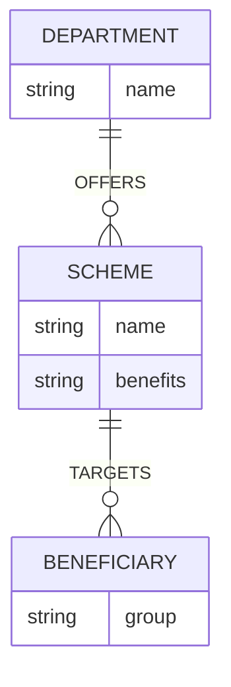
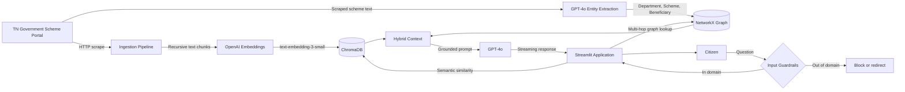

# 🏛️ Tamil Nadu Government Scheme Navigator (GraphRAG)

[](https://www.python.org/)
[](https://streamlit.io/)
[](https://www.langchain.com/)
[](https://www.trychroma.com/)
[](LICENSE)

**TN Scheme Navigator** is an AI assistant for discovering Tamil Nadu government welfare schemes. It combines semantic retrieval with a structured knowledge graph so responses can be grounded in both relevant scheme documents and verifiable department–scheme–beneficiary relationships.

> [!NOTE]
> Government scheme rules can change. Always verify eligibility, benefits, deadlines, and application procedures on the relevant official department website or through an authorized government office.

## Highlights

- **Hybrid GraphRAG retrieval** — combines ChromaDB semantic search with NetworkX graph traversal.
- **Grounded answers** — prompts the LLM to answer only from retrieved vector and graph context.
- **Domain guardrails** — redirects or blocks clearly unrelated questions.
- **Conversation memory** — preserves chat context within a Streamlit session.
- **Graph inspection** — shows graph statistics, relationships, and scheme metadata in the sidebar.
- **Graph exports** — produces PNG and PDF visualizations of the scheme knowledge graph.
- **Automated evaluation** — includes an LLM-as-a-Judge suite for faithfulness and relevance.
- **Two chatbot modes** — a polished Streamlit interface and command-line applications.

## Demo

A live deployment can be added here once one is available:

```text
https://your-streamlit-app-url
```

Screenshots can also be added with:

```markdown

```

## Knowledge Graph

The graph represents government scheme data as a directed structure:



Repository graph artifacts:

- [`scheme_graph.pkl`](scheme_graph.pkl) — serialized NetworkX graph
- [`tn_schemes_knowledge_graph.png`](tn_schemes_knowledge_graph.png) — graph visualization
- [`tn_schemes_knowledge_graph.pdf`](tn_schemes_knowledge_graph.pdf) — printable graph visualization

The generated graph currently contains **64 nodes** and **102 edges**.

## Architecture



### Request flow

1. Scheme text is scraped from the official Tamil Nadu Government portal.
2. Text is split into overlapping chunks and stored in ChromaDB using OpenAI embeddings.
3. GPT-4o extracts departments, schemes, beneficiaries, and benefit details.
4. Extracted entities are stored as a directed NetworkX graph.
5. A query triggers both vector retrieval and graph traversal.
6. The retrieved evidence is supplied to GPT-4o through a structured prompt.
7. Streamlit streams the grounded response and exposes graph metadata in the sidebar.

## Technology Stack

| Component | Technology |
| --- | --- |
| Frontend | Streamlit |
| LLM | OpenAI GPT-4o |
| Embeddings | `text-embedding-3-small` |
| Vector database | ChromaDB |
| Graph database | NetworkX |
| Optional graph database | Neo4j |
| Framework | LangChain |
| Data extraction | BeautifulSoup and Requests |
| Structured extraction | Pydantic and LangChain output parsers |
| Visualization | Matplotlib |
| Environment variables | python-dotenv |

## Project Structure

```text
TNGS_RAG_Chatbot/
├── app.py                          # Main Streamlit GraphRAG application
├── bot.py                          # Vector-RAG command-line chatbot
├── hybrid_bot.py                   # Neo4j + ChromaDB command-line chatbot
├── ingest.py                       # Scrapes schemes and builds ChromaDB
├── graph_manager.py                # Builds, loads, queries, and visualizes NetworkX graph
├── graph_ingest.py                 # Optional Neo4j graph ingestion pipeline
├── knowledge_graph.py              # In-memory knowledge graph utilities
├── evaluate_rag.py                 # LLM-as-a-Judge evaluation suite
├── export_graph.py                 # Graph export utility
├── scheme_graph.pkl                # Serialized NetworkX graph
├── tn_schemes_knowledge_graph.png  # Knowledge graph image
├── tn_schemes_knowledge_graph.pdf  # Knowledge graph PDF
├── .env                            # Local secrets (not for GitHub)
├── .gitignore
├── LICENSE
└── README.md
```

## Prerequisites

- Python 3.10 or newer
- An [OpenAI API key](https://platform.openai.com/api-keys)
- Internet access to scrape the public TN Government portal
- Optional: [Neo4j](https://neo4j.com/) for the Neo4j-backed CLI implementation

## Installation

### 1. Clone the repository

```bash
git clone https://github.com/Karthickbalakrishnan/TNGS_RAG_Chatbot.git
cd TNGS_RAG_Chatbot
```

### 2. Create a virtual environment

```bash
python3 -m venv .venv
```

Activate it:

**macOS/Linux**

```bash
source .venv/bin/activate
```

**Windows (PowerShell)**

```powershell
.venv\Scripts\Activate.ps1
```

### 3. Install dependencies

A `requirements.txt` file is not currently present in this repository. Install the packages used directly by the application:

```bash
python -m pip install --upgrade pip
python -m pip install streamlit python-dotenv requests beautifulsoup4 langchain-community langchain-openai langchain-core langchain-text-splitters networkx matplotlib pydantic chromadb
```

For the optional Neo4j chatbot, also install:

```bash
python -m pip install neo4j
```

Consider creating and committing a `requirements.txt` for reproducible installations:

```text
streamlit
python-dotenv
requests
beautifulsoup4
langchain-community
langchain-openai
langchain-core
langchain-text-splitters
networkx
matplotlib
pydantic
chromadb
neo4j
```

## Configuration

Create a `.env` file in the project root:

```dotenv
OPENAI_API_KEY=your_openai_api_key

# Required only for the Neo4j-backed implementation
NEO4J_URI=bolt://localhost:7687
NEO4j_USER=neo4j
NEO4J_PASSWORD=your_password
```

> [!IMPORTANT]
> Never commit API keys or passwords. Confirm that `.env` is included in `.gitignore` before using Git.

## Build the Databases

Run the ingestion pipeline once before starting the application:

```bash
python ingest.py
python graph_manager.py
```

These commands:

- scrape current scheme information from the TN Government portal
- create the `chroma_db/` vector store
- extract graph entities with GPT-4o
- persist the graph in `scheme_graph.pkl`
- export `tn_schemes_knowledge_graph.png` and `.pdf`

## Run the Streamlit App

```bash
streamlit run app.py
```

Open `http://localhost:8501` in a browser.

The app will:

1. request the user's name
2. load ChromaDB and the NetworkX graph
3. provide a chat interface with guardrails
4. display graph statistics and relationship samples in the sidebar
5. allow clearing the chat history

## Run the Command-Line Chatbots

### Vector-RAG chatbot

```bash
python bot.py
```

### NetworkX GraphRAG chatbot

```bash
python hybrid_bot.py
```

The `hybrid_bot.py` CLI currently uses Neo4j for graph retrieval. Start Neo4j and populate it first with:

```bash
python graph_ingest.py
python hybrid_bot.py
```

Type `exit` to end a command-line session.

## Evaluation

Run the included LLM-as-a-Judge evaluation suite:

```bash
python evaluate_rag.py
```

The suite uses GPT-4o to score responses for:

- **Faithfulness** — whether the answer stays within the supplied evidence
- **Relevance** — whether the answer directly resolves the question
- **Guardrail behavior** — whether clearly off-domain questions are rejected

The current test cases are defined in `test_dataset` inside [`evaluate_rag.py`](evaluate_rag.py). Extend this list with representative eligibility, benefit, application, and out-of-domain questions for stronger coverage.

## Example Questions

- What is UYEGP?
- What benefits does NEEDS provide?
- Which department offers farmer welfare schemes?
- Which schemes target unemployed youth?
- What documents are required for a scheme?
- How do I apply for an MSME scheme?

## Troubleshooting

### `chroma_db` or graph not found

Run:

```bash
python ingest.py
python graph_manager.py
```

### OpenAI authentication error

Verify that:

- `OPENAI_API_KEY` exists in `.env`
- the key is valid and active
- billing or usage limits are configured for the OpenAI account

### Neo4j connection error

Verify `NEO4J_URI`, `NEO4j_USER`, and `NEO4J_PASSWORD`, then confirm that Neo4j is running. Check whether your Neo4j instance uses `neo4j://` or `bolt://` for the URI.

### Portal scraping returns incomplete data

The source portal may change HTML, block automated requests, or be temporarily unavailable. Update the parsing logic in `ingest.py` or `graph_manager.py` and rerun ingestion.

### Port already in use

Use a different Streamlit port:

```bash
streamlit run app.py --server.port 8502
```

## Security and Data Notes

- API keys are loaded locally from `.env`.
- Scraped public scheme pages should be refreshed before using outdated results.
- The system is intended as a navigation assistant, not a legal or benefits determination service.
- Generated graph data may contain extraction errors and should be validated against official sources.
- Avoid entering sensitive personal information into the chatbot.

## Roadmap

- [ ] Add a `requirements.txt` or `pyproject.toml`
- [ ] Add automated unit and integration tests
- [ ] Add source citations and links for every retrieved answer
- [ ] Display live sub-graphs for the active query
- [ ] Support Tamil and English conversation
- [ ] Add persistent chat sessions
- [ ] Improve guardrails with a semantic classifier
- [ ] Add scheduled or incremental data refresh
- [ ] Publish a Docker setup for local deployment
- [ ] Expand the evaluation dataset and aggregate quality metrics

## Contributing

Contributions are welcome.

1. Fork the repository.
2. Create a descriptive branch:

   ```bash
   git checkout -b improve-scheme-retrieval
   ```

3. Make and test your changes.
4. Commit the changes:

   ```bash
   git add .
   git commit -m "Improve scheme retrieval"
   ```

5. Push the branch and open a pull request.

Please avoid committing `.env`, API keys, generated databases, or personal data.

## License

This project is licensed under the [MIT License](LICENSE).

## Disclaimer

This is an independent project for educational and experimental use. It is not an official application of the Government of Tamil Nadu. Scheme information, eligibility, benefits, and application rules should be confirmed using official government publications and the issuing department.